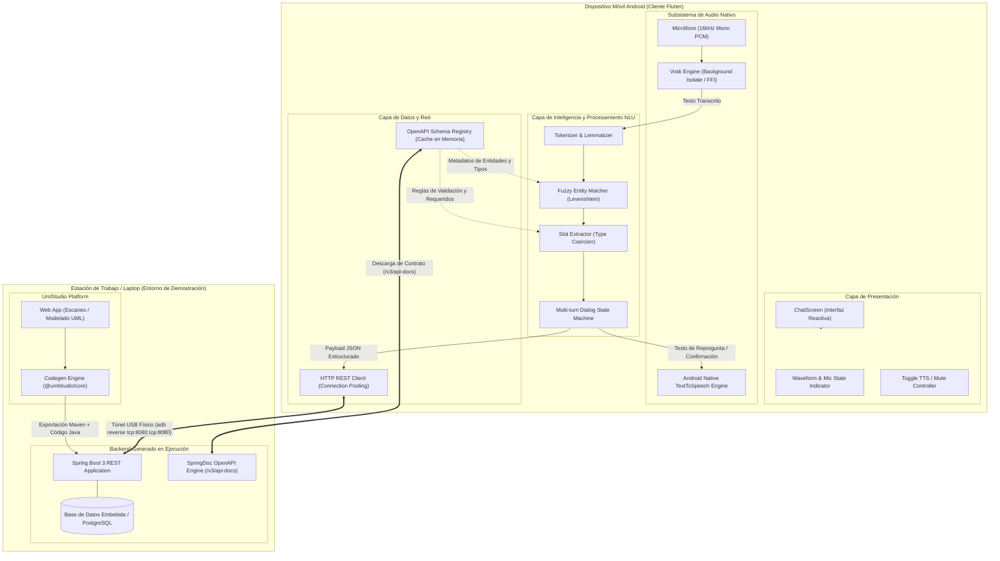

# Documento 01: Arquitectura General del Sistema, Topología y Presupuesto de Recursos

## 1. Visión y Objetivos Arquitectónicos

El sistema **UmlStudio Mobile Chat (ADB)** constituye una solución móvil de gestión conversacional para Android diseñada bajo un paradigma de **desacoplamiento total** y **cero dependencia de servicios en la nube**. La plataforma permite que un usuario final interactúe mediante lenguaje natural (hablado o escrito) con cualquier API REST generada dinámicamente por la herramienta **UmlStudio**, sin requerir conocimiento previo del dominio del negocio ni recompilación del cliente móvil.

### Objetivos Clave de Calidad
1. **Autonomía Operativa (100% Offline):** Ninguna funcionalidad del sistema (reconocimiento de voz, inferencia NLU, síntesis de voz, enrutamiento HTTP) puede depender de conectividad a Internet (WAN).
2. **Eficiencia en Recursos Críticos:** El sistema debe operar de forma estable en dispositivos Android con disponibilidad de memoria RAM de aproximadamente 1 GB libre, evitando terminaciones abruptas provocadas por el *Low Memory Killer* (LMK) de Android.
3. **Adaptabilidad Dinámica al Esquema:** El cliente móvil debe ser agnóstico a las entidades de negocio. Al recibir el contrato OpenAPI 3.0 generado por UmlStudio (`/v3/api-docs`), la aplicación debe auto-configurar su catálogo semántico, validaciones de tipos y rutas de red en tiempo de ejecución.
4. **Interacción de Manos Libres:** El flujo conversacional debe permitir la operación completa por voz, gestionando diálogos multi-turno para recolectar atributos faltantes y confirmando la ejecución mediante síntesis de voz (TTS).

---

## 2. Diagrama de Arquitectura de Contenedores (C4 Model - Nivel 2)



---

## 3. Topología de Red y Enrutamiento Físico (ADB Reverse Tunneling)

Para aislar por completo la demostración de factores ambientales externos (como saturación de bandas Wi-Fi, switches que bloquean tráfico entre clientes o ausencia de un router local), el enlace primario de comunicaciones se establece mediante un túnel por cable USB utilizando el protocolo de depuración de Android (ADB).

### 3.1 Mecanismo de Reenvío Inverso de Puertos
Cuando se ejecuta la instrucción:
```bash
adb reverse tcp:8080 tcp:8080
```
Ocurre la siguiente secuencia a nivel de socket:
1. El demonio de ADB en la computadora anfitriona (`adbd host`) abre un canal de escucha en el socket del dispositivo Android a través del puente USB.
2. El sistema operativo Android asigna el puerto local `8080` en la interfaz de bucle invertido (`127.0.0.1` / `localhost`).
3. Cualquier conexión TCP originada desde la aplicación móvil hacia `http://localhost:8080` es interceptada por el cliente ADB en el dispositivo y encapsulada en tramas USB hacia la computadora.
4. El proceso anfitrión de ADB desempaqueta las tramas y las redirige al puerto `8080` real del proceso Spring Boot.

```text
[Flutter HttpClient] 
       │
       ▼ (connect to 127.0.0.1:8080)
[Android Loopback Interface]
       │
       ▼
[adbd en el Móvil] 
       │
   === [Cable USB Físico - Protocolo ADB] ===
       │
       ▼
[adb server en la PC]
       │
       ▼ (forward to localhost:8080)
[Spring Boot (Tomcat embebido)]
```

### 3.2 Beneficios Arquitectónicos de esta Topología
* **Inmunidad ante Modo Avión:** El teléfono puede colocarse en Modo Avión estricto (Wi-Fi, Bluetooth y Datos Móviles apagados) manteniendo activa la depuración USB. Esto demuestra ante cualquier jurado que no existe telemetría externa ni uso de APIs en la nube.
* **Cero Configuración de Direcciones IP:** La aplicación móvil no requiere interfaces complejas de configuración de IP dinámica (DHCP) ni sufre ante cambios de subred. La URL base constante es `http://localhost:8080`.
* **Latencia Despreciable:** El canal físico USB ofrece latencias de ida y vuelta (RTT) inferiores a 1 milisegundo, eliminando fluctuaciones (*jitter*) de red.

---

## 4. Presupuesto Detallado de Memoria y Gestión del LMK de Android

### 4.1 La Amenaza del Low Memory Killer (LMK)
Android gestiona la memoria de forma agresiva mediante el driver de kernel `lmkd`. Cada proceso tiene asignada una puntuación `oom_score_adj` que va desde -1000 (procesos del sistema protegidos) hasta +1000 (procesos en segundo plano prescindibles). 

Cuando un dispositivo dispone de solo 1 GB de RAM libre:
* Si la aplicación aloca grandes bloques contiguos de memoria (como los requeridos para inicializar pesos de un modelo de lenguaje de 1B a 3B parámetros, que exigen entre 1.2 GB y 2.0 GB), el kernel experimenta un evento de *direct reclaim* severo.
* Al agotarse las páginas libres y la memoria de intercambio (zRAM), `lmkd` envía de inmediato una señal `SIGKILL` (código de salida 9) a la aplicación en primer plano sin posibilidad de captura de excepciones en Dart/Java.

### 4.2 Matriz de Alocación de Memoria del Sistema Propuesto

| Capa / Módulo | Componente Técnico | Memoria Residente (RSS) | Memoria Proporcional (PSS) | Justificación Técnica |
| :--- | :--- | :--- | :--- | :--- |
| **Flutter Engine** | Runtime Dart VM, Skia/Impeller, Text Layout | 45 MB – 65 MB | 35 MB – 50 MB | Carga base del motor gráfico y máquina virtual en 64 bits. |
| **Motor STT** | Vosk C-Core (`libvosk.so`), Grafos acústicos HMM | 38 MB – 48 MB | 30 MB – 40 MB | El modelo `vosk-model-small-es-0.42` utiliza un vocabulario comprimido Kaldi con modelos acotados. |
| **Buffers de Audio** | Ring Buffer PCM (16kHz 16-bit Mono) | 2 MB – 4 MB | 1 MB – 2 MB | Almacena ~2 segundos de audio en memoria para el reconocedor. |
| **Motor TTS** | Servicio Nativo de Android (`com.google.android.tts`) | 0 MB (en proceso de la app) | 0 MB (en proceso de la app) | Corre en un proceso independiente del sistema operativo; no consume cuota de la app. |
| **Esquema OpenAPI** | Árbol de descriptores AST de entidades y campos | 3 MB – 6 MB | 2 MB – 4 MB | JSON parseado en objetos livianos Dart inmutables. |
| **Estado Conversacional** | State Machine, historial de mensajes de chat | 4 MB – 8 MB | 3 MB – 5 MB | Cola de mensajes de texto en memoria con paginación visual. |
| **Total Combinado** | **UmlStudio Mobile App Completa** | **~92 MB – 131 MB** | **~71 MB – 101 MB** | **Representa menos del 15% del GB libre disponible en el dispositivo.** |

---

## 5. Modelo de Aislamiento de Hilos (Dart Isolates & Native FFI)

Para impedir caídas en la tasa de refresco visual (asegurando 60 fotogramas por segundo sostenidos en la interfaz de Flutter) y evitar bloqueos en el hilo principal durante la captura de audio y procesamiento de grafos del reconocedor, se establece una arquitectura estricta de aislamiento de tareas:

```text
┌────────────────────────────────────────────────────────┐
│                      HILO PRINCIPAL                    │
│                     (UI / Event Loop)                  │
│                                                        │
│  - Renderizado de widgets y animaciones del chat       │
│  - Control de estados de la interfaz (ViewModel)       │
│  - Recepción de cadenas transcritas finales e parciales│
│  - Orquestación de llamadas HTTP (asíncronas no        │
│    bloqueantes)                                        │
└───────────────────────────▲────────────────────────────┘
                            │
              Dart SendPort / ReceivePort
                            │
┌───────────────────────────▼────────────────────────────┐
│                    BACKGROUND ISOLATE                  │
│                    (Vosk Audio Worker)                 │
│                                                        │
│  - Interfaz FFI directa con libvosk.so                 │
│  - Lectura de flujo de bytes desde AudioRecord         │
│  - Decodificación y búsqueda en el grafo acústico Kaldi│
│  - Detección de silencios y cortes de palabra          │
└────────────────────────────────────────────────────────┘
```

1. **Hilo Principal (Main UI Isolate):**
   * Gestiona el árbol de widgets, controladores de texto, transiciones de tarjetas dinámicas y la máquina de estados de alto nivel.
   * La recepción de eventos desde la capa de audio se efectúa mediante canales asíncronos (`ReceivePort`), garantizando que la UI nunca sufra micro-pausas (*jank*).
2. **Isolate de Audio en Segundo Plano (Vosk Worker):**
   * La biblioteca nativa Vosk efectúa cálculos intensivos de transformada rápida de Fourier (FFT) y alineamiento de matrices en C++. Este trabajo se ejecuta confinado en un hilo dedicado del sistema operativo gestionado por el Isolate.
