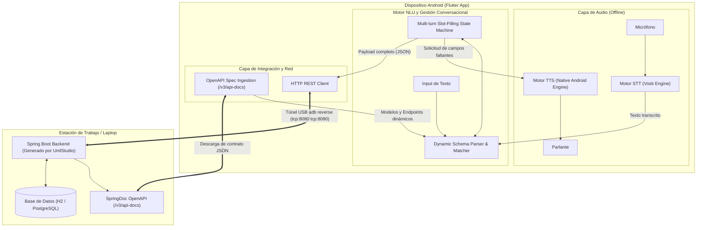

# Arquitectura General del Sistema

## 1. Resumen Ejecutivo

El presente documento detalla la arquitectura para la aplicación móvil **UmlStudio Mobile Chat (ADB)** desarrollada en Flutter. El propósito principal es proporcionar una interfaz conversacional (voz y texto) de manos libres, 100% offline, capaz de interactuar dinámicamente con cualquier API REST generada a partir de un diagrama de clases UML mediante la plataforma **UmlStudio**.

El sistema opera bajo restricciones estrictas de hardware (dispositivos Android con ~1 GB de memoria RAM libre) y sin dependencia de conexión a Internet (red local pura o túnel inverso USB vía Android Debug Bridge).

---

## 2. Diagrama de Contenedores y Flujo de Datos



---

## 3. Presupuesto de Memoria y Viabilidad de Hardware

Para garantizar que el sistema operativo Android no finalice el proceso mediante el *Low Memory Killer* (LMK) en dispositivos con solo 1 GB de RAM disponible, se descartó el uso de modelos de lenguaje generativos locales (LLM/SLM de 1B a 3B parámetros que consumen entre 1.2 GB y 2.5 GB). En su lugar, se implementa una arquitectura basada en **Vosk Acoustic Model + Gramática Dinámica + State Machine**:

| Componente | Memoria RAM Estimada | Impacto en CPU |
| :--- | :--- | :--- |
| **Flutter Framework & Skia/Impeller** | 80 MB – 120 MB | Mínimo en reposo |
| **Vosk STT (Modelo `vosk-model-small-es-0.42`)** | 35 MB – 50 MB | Moderado durante captura de audio |
| **Android Native TTS (`TextToSpeech`)** | 0 MB (Servicio nativo del SO) | Mínimo |
| **OpenAPI Schema Tree & State Machine** | 5 MB – 10 MB | Despreciable |
| **Total Estimado de la Aplicación** | **~120 MB – 180 MB** | **Completamente seguro para 1 GB RAM** |

---

## 4. Topología de Conexión y Desacoplamiento de Red

Para evitar fallas de red durante presentaciones en vivo o defensas académicas sin conexión a Internet:

1. **Conexión Física:** El teléfono inteligente se conecta mediante cable USB a la computadora portátil.
2. **Reenvío de Puertos Inverso:** Se ejecuta en la computadora:
   ```bash
   adb reverse tcp:8080 tcp:8080
   ```
3. **Punto de Enlace en la Aplicación:** La aplicación móvil apunta de forma predeterminada a:
   ```text
   http://localhost:8080
   ```
   El tráfico TCP generado en el puerto `8080` de Android es reenviado de manera transparente por el demonio ADB hacia el puerto `8080` de la computadora local donde se ejecuta Spring Boot.

---

## 5. Contrato de Integración con UmlStudio

El generador de código de `UmlStudio` produce aplicaciones Spring Boot 3 con la biblioteca `springdoc-openapi-starter-webmvc-ui` (versión 2.8.5).

* **Especificación OpenAPI:** Expuesta automáticamente en formato JSON en `http://localhost:8080/v3/api-docs`.
* **Estructura de Endpoints:**
  * Creación: `POST /api/{entidades}` con cuerpo `{Entidad}Request`.
  * Consulta individual: `GET /api/{entidades}/{id}` devolviendo `{Entidad}Response`.
  * Listado general: `GET /api/{entidades}` devolviendo `List<{Entidad}Response>`.
  * Modificación: `PUT /api/{entidades}/{id}` con cuerpo `{Entidad}Request`.
  * Eliminación: `DELETE /api/{entidades}/{id}` devolviendo código HTTP 204.

Esta regularidad en las rutas (`pluralize(toKebabCase(entity))`) y en las convenciones REST permite que el motor NLU descubra de forma autónoma los recursos y tipos de datos requeridos sin necesidad de compilaciones previas.
