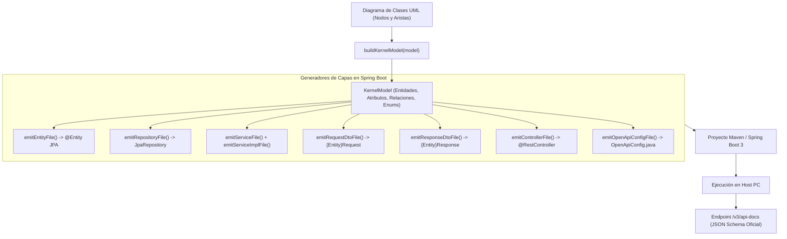
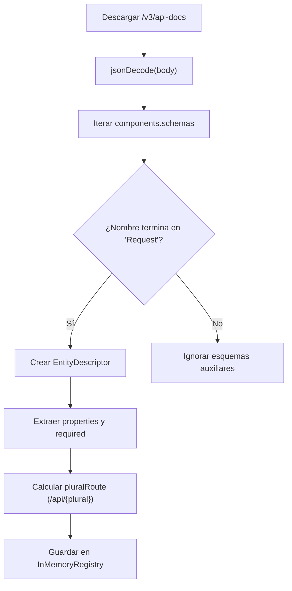

# Documento 02: Contrato OpenAPI, Generador UmlStudio y Mapeo Dinámico

## 1. El Pipeline de Generación de UmlStudio

El núcleo de generación de UmlStudio (`@umlstudio/core` y `apps/codegen`) implementa una transformación rigurosa y determinística desde un modelo de clases UML hacia un proyecto Spring Boot 3 enterprise completo. Conocer con precisión este pipeline es lo que permite que el cliente móvil funcione de manera universal frente a cualquier diagrama que el evaluador suministre.



---

## 2. Convenciones Estrictas de Código y Nombres en UmlStudio

El generador de código de UmlStudio sigue convenciones exactas sin excepciones. La aplicación móvil se apoya en estas garantías de diseño para deducir rutas y esquemas:

### 2.1 Enrutamiento de Controladores REST
En `springBootExport.ts`, el generador calcula la ruta base para cada entidad mediante la función:
```typescript
const route = pluralize(toKebabCase(entity.className))
```
Y decora la clase con:
```java
@RestController
@RequestMapping("/api/${route}")
public class ${entity.className}Controller { ... }
```

#### Ejemplos de Mapeo de Nombres
| Clase UML (`entity.className`) | Kebab-Case | Ruta Generada (`/api/{route}`) | Controlador Java |
| :--- | :--- | :--- | :--- |
| `Usuario` | `usuario` | `/api/usuarios` | `UsuarioController.java` |
| `DetalleVenta` | `detalle-venta` | `/api/detalle-ventas` | `DetalleVentaController.java` |
| `ProductoStock` | `producto-stock` | `/api/producto-stocks` | `ProductoStockController.java` |
| `Category` | `category` | `/api/categories` | `CategoryController.java` |

### 2.2 Convención de Métodos y Métricas HTTP
Cada controlador generado por UmlStudio implementa de manera idéntica las cinco operaciones estándar de persistencia:

```java
// 1. Crear nuevo registro
@PostMapping
public ResponseEntity<EntityResponse> create(@Valid @RequestBody EntityRequest request)

// 2. Obtener un registro por ID
@GetMapping("/{id}")
public ResponseEntity<EntityResponse> getById(@PathVariable Long id)

// 3. Listar todos los registros
@GetMapping
public ResponseEntity<List<EntityResponse>> getAll()

// 4. Modificar un registro existente
@PutMapping("/{id}")
public ResponseEntity<EntityResponse> update(@PathVariable Long id, @Valid @RequestBody EntityRequest request)

// 5. Eliminar un registro
@DeleteMapping("/{id}")
public ResponseEntity<Void> delete(@PathVariable Long id)
```

---

## 3. Mapeo de Tipos de Datos UML a OpenAPI 3.0

Cuando el generador de UmlStudio traduce atributos UML hacia Java, y SpringDoc genera la especificación OpenAPI, se establece la siguiente tabla de correspondencias tipadas:

| Tipo en UML | Tipo en Java | Tipo OpenAPI 3.0 | Formato OpenAPI | Coerción en Dart (Móvil) |
| :--- | :--- | :--- | :--- | :--- |
| `String`, `texto` | `String` | `string` | *(ninguno)* | `String` (texto directo) |
| `Integer`, `int` | `Integer` / `Long` | `integer` | `int32` / `int64` | `int.tryParse(input)` |
| `Double`, `float`, `Real` | `Double` / `BigDecimal` | `number` | `float` / `double` | `double.tryParse(input)` |
| `Boolean`, `bool` | `Boolean` | `boolean` | *(ninguno)* | `'true'` / `'false'` (semántico) |
| `Date`, `Fecha` | `LocalDate` | `string` | `date` | `YYYY-MM-DD` |
| `DateTime` | `LocalDateTime` | `string` | `date-time` | ISO-8601 string |
| `Enumeration` | `Java Enum` | `string` | `enum: ["A", "B"]` | Coincidencia exacta con lista |
| `Relación FK (1..*)` | `Long {targetId}` | `integer` | `int64` | ID de la entidad relacionada |

---

## 4. Estructura del Documento `/v3/api-docs`

Al solicitar `GET http://localhost:8080/v3/api-docs`, el servidor retorna una estructura JSON canónica OpenAPI 3.0.1:

```json
{
  "openapi": "3.0.1",
  "info": {
    "title": "UmlStudio API",
    "version": "1.0.0"
  },
  "paths": {
    "/api/clientes": {
      "get": {
        "summary": "Obtener todos los clientes",
        "operationId": "getAll",
        "responses": {
          "200": {
            "content": {
              "*/*": {
                "schema": {
                  "type": "array",
                  "items": {
                    "$ref": "#/components/schemas/ClienteResponse"
                  }
                }
              }
            }
          }
        }
      },
      "post": {
        "summary": "Crear un nuevo cliente",
        "operationId": "create",
        "requestBody": {
          "required": true,
          "content": {
            "application/json": {
              "schema": {
                "$ref": "#/components/schemas/ClienteRequest"
              }
            }
          }
        },
        "responses": {
          "201": {
            "description": "Created"
          }
        }
      }
    }
  },
  "components": {
    "schemas": {
      "ClienteRequest": {
        "type": "object",
        "required": ["nombre", "email", "telefono"],
        "properties": {
          "nombre": {
            "type": "string"
          },
          "email": {
            "type": "string"
          },
          "telefono": {
            "type": "string"
          },
          "saldo": {
            "type": "number",
            "format": "double"
          }
        }
      },
      "ClienteResponse": {
        "type": "object",
        "properties": {
          "id": {
            "type": "integer",
            "format": "int64"
          },
          "nombre": {
            "type": "string"
          },
          "email": {
            "type": "string"
          },
          "telefono": {
            "type": "string"
          },
          "saldo": {
            "type": "number",
            "format": "double"
          }
        }
      }
    }
  }
}
```

---

## 5. Algoritmo de Ingestión y Construcción del Registro Dinámico en Dart

El componente móvil `OpenApiParser` procesa este árbol de información sin dependencias estáticas:



### Implementación del Deserializador del Esquema en Dart
```dart
class OpenApiParser {
  static List<EntityDescriptor> parse(Map<String, dynamic> openApiJson) {
    final List<EntityDescriptor> descriptors = [];
    final components = openApiJson['components'] as Map<String, dynamic>?;
    final schemas = components?['schemas'] as Map<String, dynamic>? ?? {};

    schemas.forEach((schemaName, schemaBody) {
      if (schemaName.endsWith('Request')) {
        final entityName = schemaName.substring(0, schemaName.length - 7);
        final properties = schemaBody['properties'] as Map<String, dynamic>? ?? {};
        final requiredList = (schemaBody['required'] as List<dynamic>?)
                ?.map((e) => e.toString())
                .toSet() ??
            {};

        final List<FieldDescriptor> fields = [];
        properties.forEach((propName, propData) {
          final type = propData['type']?.toString() ?? 'string';
          final format = propData['format']?.toString();
          final enumValues = (propData['enum'] as List<dynamic>?)
              ?.map((e) => e.toString())
              .toList();

          fields.add(FieldDescriptor(
            name: propName,
            type: type,
            format: format,
            isRequired: requiredList.contains(propName),
            enumValues: enumValues,
          ));
        });

        // La ruta se calcula en función de la convención kebab-plural de UmlStudio
        final pluralRoute = _toKebabPlural(entityName);

        descriptors.add(EntityDescriptor(
          entityName: entityName,
          pluralRoute: pluralRoute,
          fields: fields,
          requiredFields: requiredList,
        ));
      }
    });

    return descriptors;
  }

  static String _toKebabPlural(String pascalCase) {
    // 1. Convertir PascalCase a kebab-case
    final kebab = pascalCase.replaceAllMapped(
      RegExp(r'(?<=[a-z])[A-Z]'),
      (Match m) => '-${m.group(0)}',
    ).toLowerCase();

    // 2. Pluralización según reglas en español/inglés del generador
    if (kebab.endsWith('s') || kebab.endsWith('x')) return '${kebab}es';
    if (kebab.endsWith('r') || kebab.endsWith('l') || kebab.endsWith('n') || kebab.endsWith('d')) {
      return '${kebab}es';
    }
    return '${kebab}s';
  }
}
```
