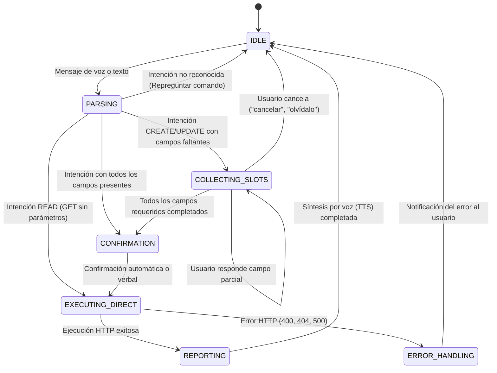

# Especificación del Motor NLU y Slot-Filling Dinámico

## 1. Introducción

El motor de comprensión de lenguaje natural (NLU) opera de manera determinística y reactiva sobre el contrato de la API expuesto por Spring Boot. Dado que el diagrama de clases es desconocido hasta el momento de la prueba, el motor no contiene entidades ni modelos predefinidos en código fuente; en su lugar, construye dinámicamente su catálogo semántico a partir del archivo `openapi.json` (`/v3/api-docs`).

---

## 2. Ingestión Dinámica del Esquema OpenAPI

Al conectarse al servidor (`http://localhost:8080/v3/api-docs`), el componente `SchemaRegistry` procesa el documento JSON y extrae una estructura optimizada en memoria:

```dart
class EntityDescriptor {
  final String entityName;          // e.g. "Cliente"
  final String pluralRoute;         // e.g. "clientes" (/api/clientes)
  final List<FieldDescriptor> fields;
  final Set<String> requiredFields;

  EntityDescriptor({
    required this.entityName,
    required this.pluralRoute,
    required this.fields,
    required this.requiredFields,
  });
}

class FieldDescriptor {
  final String name;                // e.g. "nombre", "precio", "email"
  final String type;                // "string", "integer", "number", "boolean", "date"
  final bool isRequired;
  final List<String>? enumValues;

  FieldDescriptor({
    required this.name,
    required this.type,
    required this.isRequired,
    this.enumValues,
  });
}
```

---

## 3. Clasificación de Intenciones (Intent Matching)

El sistema clasifica la entrada del usuario en cuatro intenciones operativas fundamentales mediante lemas y sinónimos en español:

| Intención | Verbos y Expresiones Clave | Método HTTP |
| :--- | :--- | :--- |
| **CREATE** | `crear`, `agregar`, `nuevo`, `nueva`, `insertar`, `registrar`, `anotar` | `POST /api/{route}` |
| **READ** | `listar`, `mostrar`, `ver`, `cuáles son`, `dame los`, `consultar`, `buscar` | `GET /api/{route}` |
| **UPDATE** | `actualizar`, `modificar`, `cambiar`, `editar`, `corregir` | `PUT /api/{route}/{id}` |
| **DELETE** | `eliminar`, `borrar`, `quitar`, `remover` | `DELETE /api/{route}/{id}` |

### Resolución de la Entidad (Entity Resolution)
Se utiliza una métrica de distancia de Levenshtein normalizada sobre los nombres de las entidades en singular, plural y su versión fonética para tolerar imprecisiones del motor de voz:
```text
Similitud = 1 - (Levenshtein(Entrada, EntidadObjetivo) / MaxLongitud)
Umbral de Aceptación: >= 0.70
```

---

## 4. Extracción de Parámetros y Valores (Slot Filling)

Una vez identificada la entidad y la intención, se analizan los atributos requeridos según el esquema:

1. **Campos Numéricos / Moneda / Cantidad:**
   * Patrones reconocidos: `"precio 500"`, `"costo de 120.50"`, `"cantidad 3"`.
   * Normalización fonética: `"quinientos"` → `500`, `"dos con cincuenta"` → `2.50`.
2. **Campos de Texto:**
   * Patrones de captura: `"llamado [VALOR]"`, `"de nombre [VALOR]"`, `"con descripción [VALOR]"`.
3. **Campos Booleanos:**
   * Expresiones de verdad: `"activo"`, `"habilitado"`, `"sí"`, `"verdadero"`.
   * Expresiones de falsedad: `"inactivo"`, `"deshabilitado"`, `"no"`, `"falso"`.
4. **Campos de Fecha:**
   * Reconocimiento de `"hoy"`, `"mañana"`, `"fecha 2026-11-03"`, `"tres de noviembre"`.

---

## 5. Máquina de Estados Conversacional (Multi-Turn)

Cuando una intención requiere campos obligatorios que no fueron provistos en la frase inicial, la conversación pasa a un estado de **recolección activa (Slot Filling)**.



### Ejemplo de Diálogo Multi-Turn

1. **Usuario:** *"Quiero registrar un nuevo cliente llamado Roberto"*
   * *Estado:* `COLLECTING_SLOTS`
   * *Entidad identificada:* `Cliente` (Ruta `/api/clientes`)
   * *Campos obtenidos:* `nombre: "Roberto"`
   * *Campos obligatorios faltantes:* `email`, `telefono`
   * *Respuesta del Sistema (Texto + Voz):* *"Entendido. ¿Cuál es el email y teléfono de Roberto?"*

2. **Usuario:** *"Su email es roberto@mail.com y teléfono 778899"*
   * *Estado:* `CONFIRMATION` -> `EXECUTING_DIRECT`
   * *Campos obtenidos:* `email: "roberto@mail.com"`, `telefono: "778899"`
   * *Todos los campos satisfechos:* Sí
   * *Petición generada:*
     ```http
     POST /api/clientes HTTP/1.1
     Host: localhost:8080
     Content-Type: application/json

     {
       "nombre": "Roberto",
       "email": "roberto@mail.com",
       "telefono": "778899"
     }
     ```

3. **Sistema:** *"Cliente Roberto registrado exitosamente con identificador 1."*
