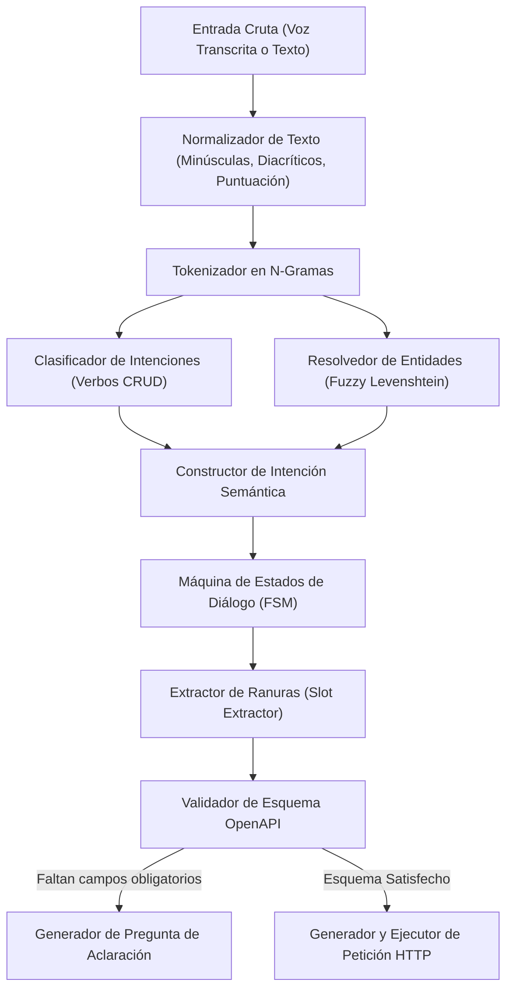

# Documento 03: Motor NLU, Gramática Dinámica y Máquina de Estados de Slot-Filling

## 1. Fundamentos Teóricos del Motor NLU Offline

Para satisfacer el requerimiento de comprensión de lenguaje natural en tiempo real dentro del límite de ~100 MB de RAM y sin dependencias de modelos LLM pesados, se diseñó un motor híbrido basado en:
1. **Normalización y Tokenización Semántica.**
2. **Clasificación de Intenciones por Léxico Operacional.**
3. **Resolución de Entidades por Similitud Fonética y Distancia de Levenshtein.**
4. **Extracción Tipada de Entidades (Slot-Filling).**
5. **Máquina de Estados Finita (FSM) Multi-Turno.**

---

## 2. Pipeline de Procesamiento del Lenguaje Natural



---

## 3. Resolución Fonética y Tolerancia a Errores en Nombres de Entidades

Los motores de voz offline (como Vosk) en entornos ruidosos pueden transcribir con ligeras variaciones ortográficas (por ejemplo: *"cleinte"* en lugar de *"cliente"*, *"usuari"* en lugar de *"usuario"*, *"detale"* en lugar de *"detalle"*).

### 3.1 Algoritmo de Distancia de Levenshtein Ponderada
La distancia de edición $D(a, b)$ entre la cadena ingresada $a$ y el nombre canónico de la entidad $b$ se normaliza en una escala de similitud $S \in [0, 1]$:

$$S(a, b) = 1.0 - \frac{Levenshtein(a, b)}{\max(|a|, |b|)}$$

```dart
double calculateSimilarity(String s1, String s2) {
  if (s1 == s2) return 1.0;
  if (s1.isEmpty || s2.isEmpty) return 0.0;

  final int len1 = s1.length;
  final int len2 = s2.length;
  List<int> current = List<int>.generate(len2 + 1, (i) => i);
  List<int> previous = List<int>.filled(len2 + 1, 0);

  for (int i = 0; i < len1; i++) {
    previous = List<int>.from(current);
    current[0] = i + 1;

    for (int j = 0; j < len2; j++) {
      final int cost = (s1[i] == s2[j]) ? 0 : 1;
      current[j + 1] = [
        current[j] + 1,       // Inserción
        previous[j + 1] + 1,   // Eliminación
        previous[j] + cost,    // Sustitución
      ].reduce((a, b) => a < b ? a : b);
    }
  }

  final int distance = current[len2];
  final int maxLen = len1 > len2 ? len1 : len2;
  return 1.0 - (distance / maxLen);
}
```

* **Regla de Aceptación:** Si $S(a, b) \ge 0.72$, la palabra se mapea a la entidad $b$. Si hay múltiples candidatos sobre el umbral, se selecciona el de mayor valor de $S$.

---

## 4. Formalización Matemática de la Máquina de Estados (FSM Multi-Turno)

La máquina de estados conversacional se define formalmente como una tupla:
$$M = (Q, \Sigma, \delta, q_0, F)$$
Donde:
* $Q = \{\text{IDLE}, \text{PARSING}, \text{COLLECTING\_SLOTS}, \text{CONFIRMING}, \text{EXECUTING}, \text{REPORTING}, \text{ERROR}\}$
* $\Sigma$: Alfabeto de eventos de entrada (órdenes del usuario, respuestas a repreguntas, eventos de red).
* $q_0 = \text{IDLE}$: Estado inicial de reposo.
* $F = \{\text{IDLE}\}$: La máquina retorna al estado de reposo tras emitir su reporte por voz.

### 4.1 Tabla de Transición de Estados

| Estado Actual ($Q$) | Evento de Entrada ($\Sigma$) | Condición de Guarda | Acción Ejecutada | Estado Siguiente ($Q'$) |
| :--- | :--- | :--- | :--- | :--- |
| **IDLE** | Recepción de voz o texto | Entrada no vacía | Normalizar y parsear tokens | **PARSING** |
| **PARSING** | Clasificación exitosa | Intención == `READ` | Disparar `GET /api/{route}` | **EXECUTING** |
| **PARSING** | Clasificación exitosa | Intención == `CREATE` y faltan campos obligatorios | Extraer slots presentes; formular repregunta | **COLLECTING_SLOTS** |
| **PARSING** | Clasificación exitosa | Intención == `CREATE` y todos los campos presentes | Construir JSON | **EXECUTING** |
| **PARSING** | Error de comprensión | Entidad o intención no resuelta | TTS: *"No entendí el comando. Repita por favor."* | **IDLE** |
| **COLLECTING_SLOTS** | Respuesta del usuario | Frase contiene *"cancelar"* o *"olvídalo"* | Limpiar slots y variables; TTS: *"Operación cancelada"* | **IDLE** |
| **COLLECTING_SLOTS** | Respuesta del usuario | Valores asignados satisfacen todos los requeridos | Construir JSON final | **EXECUTING** |
| **COLLECTING_SLOTS** | Respuesta del usuario | Aún restan campos obligatorios | Asignar slot actual; repreguntar siguiente campo | **COLLECTING_SLOTS** |
| **EXECUTING** | Respuesta HTTP | Código 200 o 201 | Generar resumen textual y disparar TTS | **REPORTING** |
| **EXECUTING** | Respuesta HTTP | Código 4xx o 5xx | Construir mensaje de error contextual | **ERROR** |
| **REPORTING** | Evento `TTS_COMPLETED` | Siempre | Limpiar contexto de diálogo; reactivar micrófono | **IDLE** |
| **ERROR** | Evento `TTS_COMPLETED` | Siempre | Restablecer estado a limpio | **IDLE** |

---

## 5. Estrategias de Extracción de Ranuras (Slot Extraction)

El extractor procesa tanto frases compuestas iniciales como respuestas breves en el diálogo de repregunta:

### 5.1 Extracción por Etiquetas Clave y Delimitadores
Cuando el usuario habla en una sola frase estructurada:
> *"Registrar cliente con nombre Carlos, email carlos@empresa.com y teléfono 445566"*

Se aplican patrones regulares dinámicos construidos a partir de los nombres de los atributos de la entidad:
```dart
for (final field in entity.fields) {
  // Patrón: nombre [delimitador]? [VALOR] (hasta el próximo campo o final de frase)
  final pattern = RegExp(
    '\\b(?:${field.name}|${_getSynonyms(field.name)})\\b(?:\\s+(?:es|de|con|=|:))?\\s+([^,]+?)(?=\\s+\\b(?:${allFieldNames.join('|')})\\b|\$)',
    caseSensitive: false,
  );
  final match = pattern.firstMatch(text);
  if (match != null) {
    slots[field.name] = _coerceType(match.group(1)!.trim(), field.type);
  }
}
```

### 5.2 Extracción Secuencial en Modo Conversacional
Cuando el sistema repregunta:
> *Sistema:* *"¿Cuál es el email de Carlos?"*
> *Usuario:* *"carlos@empresa.com"*

La máquina de estados mantiene el puntero al `targetField` activo (`email`). Por lo tanto, no se requiere que el usuario repita la palabra clave *"email"*; el valor íntegro de la respuesta se valida contra el tipo del campo y se asigna directamente.

### 5.3 Manejo de Relaciones y Claves Foráneas (Foreign Keys)
En UmlStudio, cuando una entidad tiene una relación (por ejemplo: `Venta` con `Cliente`), el DTO generado incluye típicamente el campo `clienteId`:
* Si el usuario dice *"Venta para el cliente 5"*, el sistema detecta la asociación y extrae `clienteId = 5`.
* Si el campo `clienteId` es obligatorio y falta, el sistema repreguntará: *"¿Cuál es el identificador o ID del cliente para esta venta?"*.
