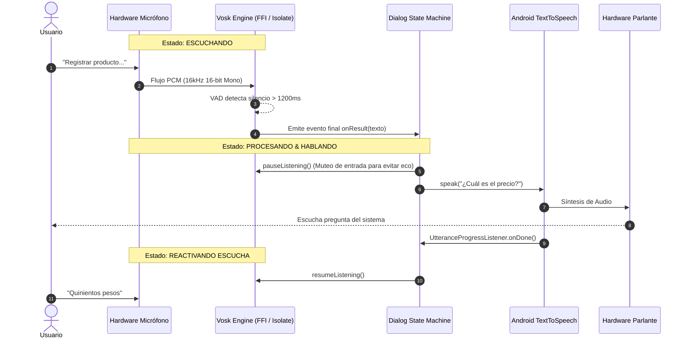

# Documento 04: Pipeline de Audio Offline: Reconocimiento (STT) y Síntesis (TTS)

## 1. Visión General del Pipeline de Audio

El subsistema de audio procesa la captura acústica y la reproducción de voz sin recurrir a ninguna API en la nube. Este documento detalla la calibración de hardware, los parámetros de muestreo, el aislamiento de procesos y el ciclo de sincronización para evitar retroalimentación acústica (*eco*).



---

## 2. Parámetros Técnicos de Captura de Audio

Para que el modelo acústico de Vosk opere con la máxima precisión fonética en español con el menor consumo de CPU:

* **Frecuencia de Muestreo (Sample Rate):** `16,000 Hz` (16 kHz). Es la frecuencia nativa con la que fue entrenado el modelo HMM-DNN de Kaldi. Muestrear a 44.1 kHz o 48 kHz desperdicia ciclos de CPU en remuestreo (*downsampling*) innecesario.
* **Formato de Codificación:** `PCM 16-bit Signed Integer (Little-Endian)`.
* **Canales:** `1 Canal (Mono)`. El canal estéreo duplica el consumo de memoria sin aportar mejoras al reconocimiento.
* **Tamaño del Buffer de Grabación (AudioRecord Buffer):**
  Calculado para ofrecer un compromiso óptimo entre latencia y sobrecarga de interrupciones:
  $$\text{Buffer Size} = 16000 \times 2 \text{ bytes/muestra} \times 0.2 \text{ segundos} = 6400 \text{ bytes (3200 muestras)}$$

---

## 3. Implementación y Carga del Modelo Vosk en Android

El modelo `vosk-model-small-es-0.42` consta de:
1. `am/`: Modelos acústicos cuantizados.
2. `graph/`: Autómata finito determinista (FST) de transiciones fonéticas y léxicas.
3. `conf/`: Parámetros de extracción de características MFCC (Mel-Frequency Cepstral Coefficients).

### Inyección de Vocabulario Dinámico (Grammar Boosting)
Una característica avanzada de Vosk es la capacidad de restringir o ponderar la búsqueda del reconocedor mediante una gramática JSON temporal. Al ingerir el esquema OpenAPI de UmlStudio, se inyectan dinámicamente los nombres de las entidades en la gramática del reconocedor:

```dart
Future<void> updateRecognizerGrammar(List<String> entityNames) async {
  final baseVerbs = ['crear', 'agregar', 'nuevo', 'listar', 'mostrar', 'ver', 'eliminar', 'cancelar'];
  final numbers = ['cero', 'uno', 'dos', 'tres', 'cuatro', 'cinco', 'seis', 'siete', 'ocho', 'nueve', 'diez'];
  
  final fullVocabulary = [
    ...baseVerbs,
    ...entityNames.map((e) => e.toLowerCase()),
    ...numbers,
    "[unk]" // Token para palabras desconocidas fuera del vocabulario
  ];

  final grammarJson = jsonEncode(fullVocabulary);
  // Vosk reconfigura su grafo de búsqueda en caliente (~2ms)
  await _recognizer?.setGrammar(grammarJson);
}
```

---

## 4. Detección de Actividad de Voz (VAD) y Control de Silencio

Para que la experiencia sea genuinamente de manos libres, el sistema no debe exigir que el usuario presione un botón para finalizar de hablar.

1. **Monitoreo de Energía RMS (Root Mean Square):**
   $$RMS = \sqrt{\frac{1}{N}\sum_{i=1}^{N} x[i]^2}$$
   Si el valor RMS decae por debajo del umbral de ruido de fondo durante más de 1200 milisegundos consecutivos tras haber detectado habla activa, Vosk asume el fin de la elocución (*end-of-speech*).
2. **Corte y Emisión Inmediata:** Vosk emite de inmediato el JSON estructurado:
   ```json
   {
     "text": "registrar nuevo cliente"
   }
   ```

---

## 5. Prevención de Retroalimentación Acústica (Acoustic Echo Prevention)

El mayor desafío técnico de una interfaz de voz manos libres en un dispositivo móvil con altavoz y micrófono activos simultáneamente es el **bucle de eco**: el micrófono capta la propia voz del motor TTS al formular una pregunta, confundiéndola con una orden del usuario.

### Estrategia de Muteo Asíncrono de Micrófono
1. Antes de iniciar la síntesis de audio mediante `flutter_tts`, la aplicación ejecuta:
   ```dart
   await audioService.pauseListening();
   ```
2. La llamada a `flutter_tts.speak()` se realiza configurando el modo síncrono de espera:
   ```dart
   await flutter_tts.awaitSpeakCompletion(true);
   await flutter_tts.speak(textPrompt);
   ```
3. Una vez finalizada la emisión acústica por el altavoz, se introduce una ventana de guarda de seguridad de `150 milisegundos` para disipar cualquier reverberación acústica en la habitación:
   ```dart
   await Future.delayed(const Duration(milliseconds: 150));
   await audioService.resumeListening();
   ```

---

## 6. Configuración y Parámetros del Motor Nativo TTS

El motor de síntesis de voz se inicializa aprovechando la configuración del sistema Android:

```dart
class TtsEngineManager {
  final FlutterTts _tts = FlutterTts();

  Future<void> configure() async {
    // Verificación de disponibilidad del motor en español
    final languages = await _tts.getLanguages;
    if (languages.contains("es-ES") || languages.contains("es_ES")) {
      await _tts.setLanguage("es-ES");
    } else {
      await _tts.setLanguage("es-US");
    }

    // Parámetros auditivos optimizados para comprensión rápida en aula/defensa
    await _tts.setSpeechRate(0.52);   // 52% velocidad (ágil pero inteligible)
    await _tts.setPitch(1.0);         // Tono natural estándar
    await _tts.setVolume(1.0);        // Ganancia máxima de volumen
    
    // Forzar enrutamiento por el canal de medios STREAM_MUSIC
    await _tts.setIosAudioCategory(IosTextToSpeechAudioCategory.playback, [
      IosTextToSpeechAudioCategoryOptions.defaultToSpeaker
    ]);
  }
}
```
