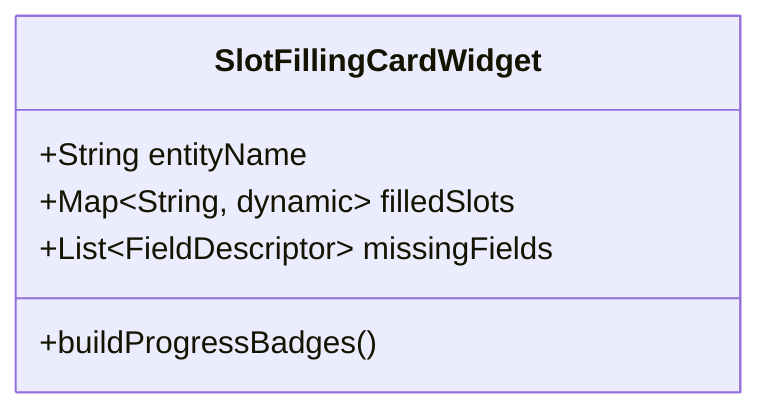

# Documento 05: Diseño de UI/UX y Sistema Visual Conversacional

## 1. Filosofía de Diseño: "Claridad Inmediata y Manos Libres"

La interfaz de usuario está diseñada específicamente para escenarios de demostración y evaluación académica en vivo. La pantalla debe comunicar visualmente y con absoluta transparencia lo que el motor de voz está transcribiendo, el estado de la máquina de diálogo, los campos que se están recolectando y la respuesta estructurada devuelta por el servidor.

---

## 2. Wireframe de la Pantalla Principal (Chat Screen)

```text
┌────────────────────────────────────────────────────────┐
│  UmlStudio Mobile Chat               [🔊 TTS] [⚙ IP]  │
│  🟢 Conectado: localhost:8080 | 4 Entidades detectadas  │
├────────────────────────────────────────────────────────┤
│                                                        │
│  🤖 Asistente                                10:14 AM  │
│  ┌──────────────────────────────────────────────────┐  │
│  │ Esquema OpenAPI sincronizado.                    │  │
│  │ Entidades disponibles: Cliente, Producto, Venta. │  │
│  │ Di un comando como: "Registrar nuevo Cliente"    │  │
│  └──────────────────────────────────────────────────┘  │
│                                                        │
│                                           👤 Usuario   │
│                 ┌───────────────────────────────────┐  │
│                 │ Quiero crear un nuevo cliente con │  │
│                 │ nombre Carlos                     │  │
│                 └───────────────────────────────────┘  │
│                                                        │
│  🤖 Asistente                                10:15 AM  │
│  ┌──────────────────────────────────────────────────┐  │
│  │ 📋 Recolectando datos para [Cliente]:            │  │
│  │  • nombre: Carlos                    ✅         │  │
│  │  • email:  (Pendiente)              ⏳ Requerido│  │
│  │  • telefono: (Pendiente)            ⏳ Requerido│  │
│  │                                                  │  │
│  │ "¿Cuál es el email y teléfono de Carlos?"        │  │
│  └──────────────────────────────────────────────────┘  │
│                                                        │
│                                           👤 Usuario   │
│                 ┌───────────────────────────────────┐  │
│                 │ Email carlos@demo.com y teléfono  │  │
│                 │ 998877                            │  │
│                 └───────────────────────────────────┘  │
│                                                        │
│  🤖 Asistente (HTTP 201 Created)             10:15 AM  │
│  ┌──────────────────────────────────────────────────┐  │
│  │ ✅ Cliente registrado exitosamente               │  │
│  │ ID: 1 | Nombre: Carlos | Email: carlos@demo.com  │  │
│  └──────────────────────────────────────────────────┘  │
│                                                        │
├────────────────────────────────────────────────────────┤
│  [ ••• Onda de Audio Activa - Escuchando... ••• ]      │
├────────────────────────────────────────────────────────┤
│  [ ⌨ Escribir mensaje manual... ]          [ 🎤 MIC ] │
└────────────────────────────────────────────────────────┘
```

---

## 3. Componentes Visuales Especializados

### 3.1 Indicador de Estado de Conexión y Esquema
Ubicado en la parte superior (*AppBar Subtitle*), indica reactivamente el estado de la comunicación con el backend:
* 🟢 **Verde (Sincronizado):** Muestra la URL base y la cantidad de entidades descubiertas (ej. `localhost:8080 | 4 Entidades`).
* 🟡 **Amarillo (Sincronizando):** Muestra un indicador de carga durante el `GET /v3/api-docs`.
* 🔴 **Rojo (Desconectado):** Permite presionar para reintentar la conexión o verificar el túnel ADB.

### 3.2 Tarjeta de Progreso de Recolección de Campos (Slot-Filling Card)
Cuando la máquina de estados ingresa en `COLLECTING_SLOTS`, la burbuja del chat renderiza una tarjeta interactiva con el estado de cada atributo:


* **Campos Completados:** Fondo verde translúcido con ícono de verificación (✅).
* **Campos Requeridos Pendientes:** Fondo ámbar con etiqueta parpadeante `Requerido`.
* **Botón de Cancelar:** Permite al usuario abortar la operación táctilmente sin esperar el comando de voz.

### 3.3 Tarjetas de Respuesta Estructurada (GET Lists)
Cuando el usuario solicita *"Listar productos"*, la respuesta no se despliega como texto crudo, sino como una lista de tarjetas desplazables con los campos destacados:

```dart
Widget buildEntityCard(Map<String, dynamic> item, String entityName) {
  final id = item['id'] ?? '-';
  final title = item['nombre'] ?? item['descripcion'] ?? item['codigo'] ?? '$entityName #$id';

  return Card(
    elevation: 2,
    margin: const EdgeInsets.symmetric(vertical: 4),
    shape: RoundedRectangleBorder(borderRadius: BorderRadius.circular(12)),
    child: ListTile(
      leading: CircleAvatar(
        backgroundColor: Colors.blueAccent,
        child: Text('#$id', style: const TextStyle(color: Colors.white, fontSize: 12)),
      ),
      title: Text(title.toString(), style: const TextStyle(fontWeight: FontWeight.bold)),
      subtitle: Column(
        crossAxisAlignment: CrossAxisAlignment.start,
        children: item.entries
            .where((e) => e.key != 'id' && e.key != 'nombre')
            .map((e) => Text('${e.key}: ${e.value}', style: const TextStyle(fontSize: 12)))
            .toList(),
      ),
    ),
  );
}
```

### 3.4 Visualizador de Onda de Audio y Botón Manos Libres
* **Visualizador de Audio:** Barra animada en la parte inferior que reacciona a los eventos de amplitud del micrófono, permitiendo al evaluador ver físicamente que el sistema está escuchando y procesando.
* **Control de Voz (TTS Switch):** Botón flotante accesible en todo momento para silenciar el sintetizador de voz en caso de que el aula de examen requiera silencio o el jurado prefiera leer en pantalla.
