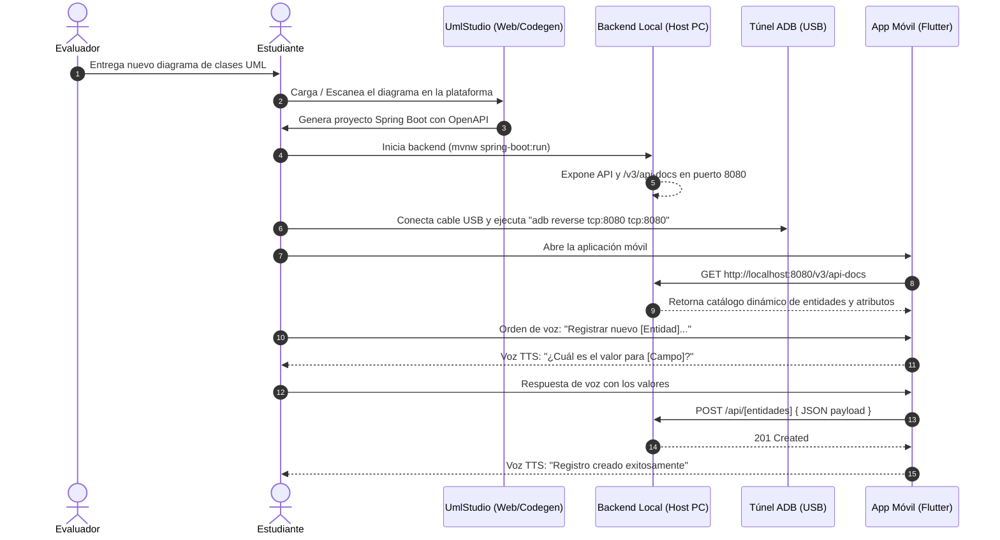

# Guía de Ejecución Paso a Paso y Protocolo de Defensa

## 1. Preparación Previa al Examen / Presentación

Antes del día de la presentación, asegúrese de haber verificado los siguientes componentes en el entorno local:

1. **Android SDK y Herramienta ADB:** Comprobar que `adb` esté accesible en la terminal del sistema:
   ```bash
   adb version
   ```
2. **Depuración USB en el Teléfono Móvil:**
   * Activar las *Opciones de Desarrollador* en Android.
   * Habilitar la opción **Depuración por USB (USB Debugging)**.
3. **Paquete del Modelo Acústico Vosk:**
   * Verificar que el archivo comprimido o directorio `vosk-model-small-es-0.42` esté incluido dentro de `assets/models/` en la aplicación de Flutter.
4. **Motor TTS del Sistema:**
   * Verificar en la configuración de Android (*Ajustes > Idioma e introducción de texto > Síntesis de voz*) que el motor de voz en español esté instalado y operativo.

---

## 2. Protocolo de Ejecución el Día de la Defensa



---

## 3. Comandos de Terminal en la Laptop

### Paso 1: Compilación e Inicio del Backend Generado
Una vez descargado el código generado por `UmlStudio`:
```bash
cd backend-generado/
./mvnw clean spring-boot:run
```
*Comprobación rápida:* Abrir en el navegador de la laptop `http://localhost:8080/v3/api-docs` para confirmar que el JSON del esquema esté disponible.

### Paso 2: Establecimiento del Túnel Inverso
Con el teléfono conectado por cable USB a la laptop:
```bash
adb devices
# Comprobar que el dispositivo figure como "device" y no "unauthorized"

adb reverse tcp:8080 tcp:8080
```
*Efecto:* A partir de este momento, cualquier petición realizada por el teléfono a `http://localhost:8080` se dirigirá directamente al Spring Boot en la laptop, sin importar si el Wi-Fi está apagado.

---

## 4. Guion de Demostración Práctica (Live Demo)

### Caso A: Verificación de Desconexión Total (Offline Proof)
1. Apagar el Wi-Fi de la computadora portátil.
2. Activar el Modo Avión en el teléfono móvil (manteniendo la depuración USB encendida).
3. Mostrar al evaluador que no hay conexión externa ni acceso a servidores de terceros.

### Caso B: Ingestión del Nuevo Esquema
1. Abrir la aplicación Flutter en el teléfono.
2. Tocar el botón **Sincronizar Esquema** (o dejar que inicie automáticamente).
3. La aplicación indicará en pantalla y por voz: *"Esquema sincronizado. Se detectaron N entidades: [Entidad1, Entidad2, ...]"*.

### Caso C: Consulta de Datos (Lectura / GET)
1. Presionar el micrófono o activar el modo manos libres.
2. Expresar: *"Listar [nombre de entidad en plural]"* (ejemplo: *"Listar usuarios"* o *"Mostrar productos"*).
3. La aplicación consultará `GET /api/{entidades}`, mostrará las tarjetas de resultados en el chat y el motor TTS sintetizará: *"Se encontraron 0 registros para [Entidad]"* (o la cantidad existente).

### Caso D: Creación con Preguntas de Aclaración (Multi-Turn Slot-Filling)
1. Expresar: *"Quiero agregar un [Entidad] de nombre Carlos"*.
2. El motor NLU identificará que faltan campos obligatorios definidos en el diagrama del profesor (por ejemplo, `email` y `telefono`).
3. El sistema responderá por texto y voz: *"¿Cuál es el valor para el campo obligatorio: email, telefono?"*.
4. Expresar: *"Su email es carlos@test.com y su telefono es 123456"*.
5. La aplicación completará el objeto JSON, ejecutará `POST /api/{entidades}` y confirmará por audio: *"Registro de [Entidad] creado exitosamente en el servidor"*.

---

## 5. Matriz de Resolución de Problemas Frecuentes

| Síntoma | Causa Probable | Solución Inmediata |
| :--- | :--- | :--- |
| `SocketException: Connection refused` | Spring Boot no terminó de levantar o el túnel ADB no fue ejecutado. | Reejecutar `adb reverse tcp:8080 tcp:8080` y comprobar que la consola de Spring Boot diga `Started Application in X seconds`. |
| `adb: error: device unauthorized` | El teléfono no aceptó la huella digital RSA de la computadora. | Desconectar y reconectar el cable USB; aceptar el diálogo emergente en la pantalla del celular *"¿Permitir depuración USB?"*. |
| Vosk no transcribe o tarda en responder | Permiso de grabación denegado o archivo de modelo no encontrado. | Comprobar que la aplicación tenga concedido el permiso `RECORD_AUDIO` en *Ajustes de la App* y que el asset `vosk-model-small-es-0.42` esté correctamente referenciado. |
| La síntesis TTS no emite sonido | Volumen multimedia del teléfono silenciado o motor TTS sin datos en español. | Subir el volumen multimedia de Android y verificar que en los ajustes del sistema la voz de muestra en español se escuche con normalidad. |
