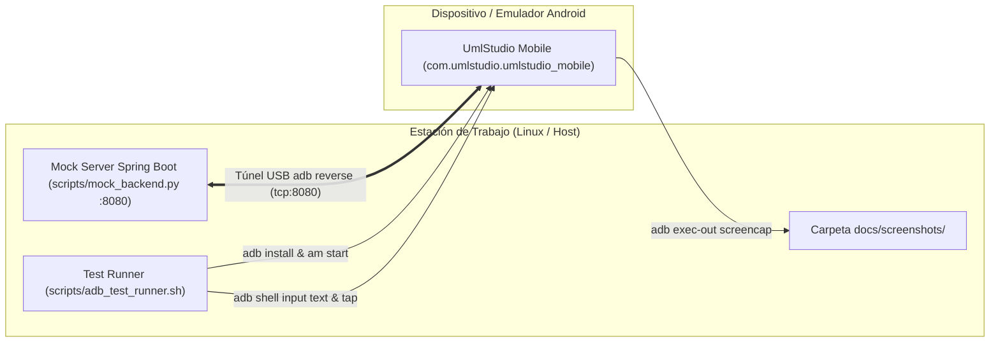

# Documento 09: Plan de Pruebas Automatizadas vía ADB y Captura de Evidencias Visuales

## 1. Objetivo del Plan de Pruebas

Este documento establece el procedimiento automatizado para la verificación integral del cliente móvil **UmlStudio Mobile Chat**, asegurando que la integración entre el túnel inverso de red (`adb reverse`), el ingestor de OpenAPI (`/v3/api-docs`), la máquina de estados NLU y la interfaz de usuario con diseño UmlStudio se ejecuten de manera continua, registrando evidencias fotográficas (*screenshots*) en cada hito funcional.

---

## 2. Arquitectura del Entorno de Pruebas Automatizado



---

## 3. Matriz de Casos de Prueba Automatizados

| ID | Escenario de Prueba | Acción Inyectada por ADB | Resultado Esperado | Evidencia Visual Generada |
| :---: | :--- | :--- | :--- | :--- |
| **TC-01** | **Arranque y Sincronización OpenAPI** | Lanzamiento de Activity con `am start`. Espera de 4s para handshake HTTP. | Barra superior muestra `🟢 Conectado \| 2 Entidades`. Fondo de cuadrícula técnica activo. | `01_home_synced.png` |
| **TC-02** | **Consulta GET Directa** | Inyección de texto `Listar clientes` y tecla `ENTER` (código 66). | Se consulta `GET /api/clientes`. El asistente responde en chat confirmando registros existentes. | `02_list_query.png` |
| **TC-03** | **Inicio de Creación Multi-Turno** | Inyección de texto `Crear nuevo producto` sin parámetros. | FSM entra en `COLLECTING_SLOTS`. El asistente repregunta por voz y texto los campos obligatorios: `nombre, precio`. | `03_slot_filling_prompt.png` |
| **TC-04** | **Completitud de Slots y HTTP POST** | Inyección secuencial de `Teclado Mecanico` y `85.50`. | FSM valida todos los tipos requeridos, despacha `POST /api/productos` con payload JSON y confirma la creación exitosa con código HTTP 201. | `04_created_success.png` |

---

## 4. Componentes Implementados para la Ejecución

1. **Servidor Mock de Backend (`scripts/mock_backend.py`):**
   * Emula a Spring Boot con SpringDoc OpenAPI en el puerto 8080.
   * Expone el contrato canónico OpenAPI 3.0.1 en `/v3/api-docs`.
   * Mantiene en memoria las colecciones `/api/clientes` y `/api/productos`.
   * Cero dependencias externas (Python 3 estándar).

2. **Ejecutor Automatizado ADB (`scripts/adb_test_runner.sh`):**
   * Detecta automáticamente el dispositivo o emulador activo.
   * Ejecuta `adb reverse tcp:8080 tcp:8080`.
   * Instala el APK con permisos concedidos automáticamente (`-g`).
   * Despacha los eventos de entrada táctil y texto por ADB.
   * Extrae capturas de pantalla de alta resolución mediante `adb exec-out screencap -p`.

---

## 5. Instrucciones de Ejecución Inmediata

### Terminal 1: Iniciar el Backend
```bash
python3 scripts/mock_backend.py
```

### Terminal 2: Conectar Dispositivo y Disparar Pruebas
```bash
# 1. Asegurarse de que el teléfono esté conectado con depuración USB:
adb devices

# 2. Ejecutar la batería de pruebas completa con capturas de pantalla:
./scripts/adb_test_runner.sh
```

Las capturas quedarán almacenadas en [`docs/screenshots/`](file:///home/scandal/Descargas/Proyectos/UmlStudioADB/docs/screenshots/) listas para ser inspeccionadas.
